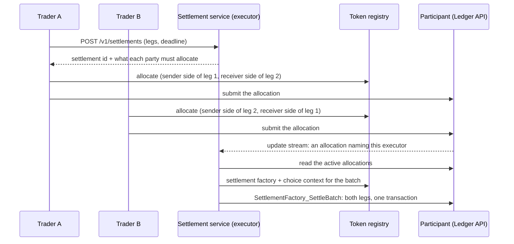

# Canton settlement service

A delivery-versus-payment (DvP) settlement service for the Canton Network.
It is built on the [Canton Rust SDK](https://github.com/nodejumper-org/canton-rust-sdk)
and the CIP-0112 (V2) token standard. It is the SDK's reference application:
a long-running service that does one real job using the SDK's public API
only.

It runs as a settlement **executor**:
- Counterparties agree a trade off-ledger and register it here. A trade is one
  or more legs, each "`amount` of `instrument` from `sender` to `receiver`".
- Each counterparty allocates its side under the token standard, naming this
  service as executor.
- When every leg is authorised on both sides, the service settles all legs in
  **one transaction**. Either everything moves, or nothing does.
- If the deadline passes first, it cancels the allocations, and everyone's
  holdings are released.

A public instance runs on the Canton Network **DevNet**, with demo traders
trading with each other every few minutes: <http://144.31.141.231:8080>.

## How it works



**The update stream is the signal; the active contract set is the truth.**
- **Streaming:** the service follows the update stream
  (`updates_resumable_typed_with`), filtered to the token standard's
  `Allocation` interface. It does not trust what an update says. An update only
  tells it to look again.
- **Deciding:** what it looks at is the active contract set, read through the
  same interface. On every pass it re-decides each settlement from scratch. A
  missed, duplicated or reordered update cannot leave the service believing
  something the ledger does not hold.
- **Safety net:** a timer runs the same pass when the stream is quiet.

**Resuming.** The stream position is saved after every update and resumed from
on restart. If the participant has pruned that position, the SDK reports where
readable history begins (`Error::pruned_earliest_offset`). The service then
moves to the ledger end; nothing is lost by that, because the next pass
re-reads the active contract set.

**Deciding "ready".** A settlement is ready when every leg has both sides
authorised. That means:
- a **sender-side** allocation by the sender, reserving the holdings;
- a **receiver-side** allocation by the receiver, consenting to be paid.

Each side must match the agreed leg exactly: authorizer, counterparty, amount
and instrument. A side that disagrees is reported as a **mismatch** and is
never settled, so a wrong allocation cannot move something nobody agreed to.
Allocations past their own deadline or expiry authorise nothing. A duplicate
allocation (a retried one, say) is left out of the batch. All of this is one
pure function, `model::evaluate`, with unit tests for each case.

**Settling once.** `SettlementFactory_SettleBatch` goes through the SDK's
submission handle, so the command's identity is fixed before it is sent. If
the response is lost, the service does not resubmit blind. It reads the
outcome back from the completion stream by that identity (`Submission::recover`).

**Expiry.** Past its deadline a settlement is not settled. Every allocation
still reserved for it is cancelled (`Allocation_Cancel`, the executor's
choice), so no trader's holdings stay locked.

## API

Reads are open. Registering a settlement needs `SETTLEMENT_API_KEY` as a
bearer token; without a key the API is read-only.

| Method | Path | |
|---|---|---|
| `POST` | `/v1/settlements` | Register a settlement. Returns its id, the executor, the registry admin, and what each party must allocate. |
| `GET` | `/v1/settlements?status=pending&limit=50` | Recent settlements, newest first. |
| `GET` | `/v1/settlements/{id}` | One settlement:<br>• its legs and status<br>• the last pass's view: which sides are still missing, any mismatch<br>• its history |
| `GET` | `/healthz` | The service, and whether the participant answers. |
| `GET` | `/metrics` | Prometheus metrics, the SDK's own included. |
| `GET` | `/` | A status page. |

```sh
curl -X POST http://localhost:8080/v1/settlements \
  -H "Authorization: Bearer $SETTLEMENT_API_KEY" -H 'Content-Type: application/json' \
  -d '{
        "legs": [
          { "sender": "alice::1220…", "receiver": "bob::1220…",   "instrument_id": "Amulet", "amount": "10.0" },
          { "sender": "bob::1220…",   "receiver": "alice::1220…", "instrument_id": "Amulet", "amount": "5.0" }
        ],
        "ttl_secs": 3600
      }'
```

The response's `allocations_needed` lists, per party, the sides to put in one
allocation. Each party then allocates with:
- the returned settlement `id`;
- this service's party as the only executor;
- a settlement deadline no later than the settlement's `settle_before`.

With the Canton Rust SDK that is `canton::token::v2::allocate`. The SDK's
[`v2_allocate`](https://github.com/nodejumper-org/canton-rust-sdk/blob/main/crates/canton-token/examples/v2_allocate.rs)
example does exactly this from the command line.

## Configuration

All configuration is environment variables. [`deploy/.env.example`](deploy/.env.example)
lists them with comments.

| Variable | |
|---|---|
| `SETTLEMENT_LEDGER_URL` | The participant's gRPC Ledger API. |
| `SETTLEMENT_OIDC_TOKEN_URL`, `SETTLEMENT_OIDC_CLIENT_ID`, `SETTLEMENT_OIDC_CLIENT_SECRET`, `SETTLEMENT_OIDC_AUDIENCE` | OIDC client credentials for the ledger user. Alternatively `SETTLEMENT_LEDGER_TOKEN`, a token as issued. |
| `SETTLEMENT_REGISTRY_URL` | The token-standard registry. For Amulet, a Scan URL. |
| `SETTLEMENT_EXECUTOR_PARTY` | The executor party. The ledger user needs `CanActAs` on it. |
| `SETTLEMENT_API_KEY` | Bearer key for registering settlements. |
| `SETTLEMENT_DB` | SQLite file. Default `settlement.db`, or `/data/settlement.db` in the image. |
| `SETTLEMENT_LISTEN` | Default `0.0.0.0:8080`. |
| `SETTLEMENT_RECONCILE_SECS` | How often the active contract set is re-read without a signal. Default 30. |
| `SETTLEMENT_DEFAULT_TTL_SECS` | A settlement's deadline when the request names none. Default 3600. |
| `SETTLEMENT_DEMO_TRADER_A`, `SETTLEMENT_DEMO_TRADER_B` | Turn on the demo traders. The ledger user needs `CanActAs` on both. |
| `SETTLEMENT_DEMO_INSTRUMENT`, `SETTLEMENT_DEMO_AMOUNT_A`, `SETTLEMENT_DEMO_AMOUNT_B`, `SETTLEMENT_DEMO_EVERY_SECS` | What the demo trades, and how often. Defaults: Amulet, 0.1, 0.05, every 900 s. |
| `SETTLEMENT_LOG_FORMAT` | `json` for JSON logs. `RUST_LOG` sets the level. |

**The demo traders.** In production each counterparty allocates from its own
wallet with its own credentials. In demo mode the service's ledger user acts
for both traders. That is acceptable only for demo parties on a test network.

## Running

The image is published to GHCR on every push to `main`:

```sh
cd deploy
cp .env.example .env    # fill it in
docker compose up -d
docker compose logs -f
```

From source (Rust 1.88+):

```sh
cargo run --release
```

Against a local network, the SDK's
[local development guide](https://github.com/nodejumper-org/canton-rust-sdk)
describes the LocalNets it is tested on. Point `SETTLEMENT_LEDGER_URL` and
`SETTLEMENT_REGISTRY_URL` at one and set the parties.

## What it uses from the SDK

| Need | Canton Rust SDK |
|---|---|
| Ledger connection, OIDC tokens, retries | `canton::ledger::CantonClient`, `canton::auth::TokenProvider` |
| Allocations from the active contract set | `ActiveContractsRequest::for_interfaces`, `canton::daml::from_record` |
| The update stream, resumable, typed | `updates_resumable_typed_with`, `canton::ledger::update::Update` |
| A pruned resume point | `Error::pruned_earliest_offset` |
| Allocate, settle a batch, cancel | `canton::token::v2::{allocate, settle_batch, cancel}` |
| Spendable holdings | `canton::token::holdings::spendable` |
| Exactly-once settlement | `CantonClient::submission`, `Submission::recover` |
| Generated token-standard types | `canton::token::types::v2::{allocation, holding}` |

## Development

```sh
cargo fmt --all --check
cargo clippy --all-targets -- -D warnings
cargo test
```

## License

Apache-2.0. See [LICENSE](LICENSE).
